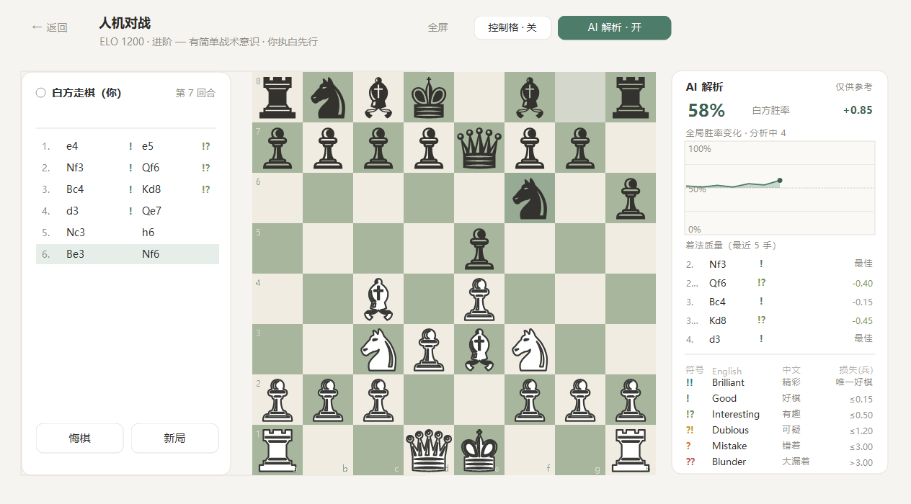
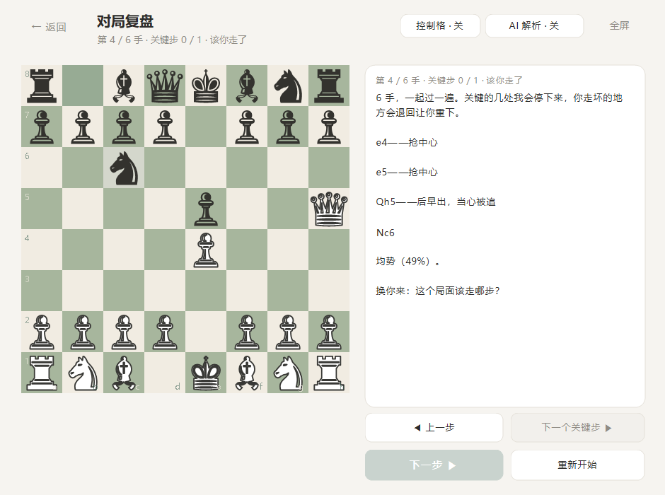
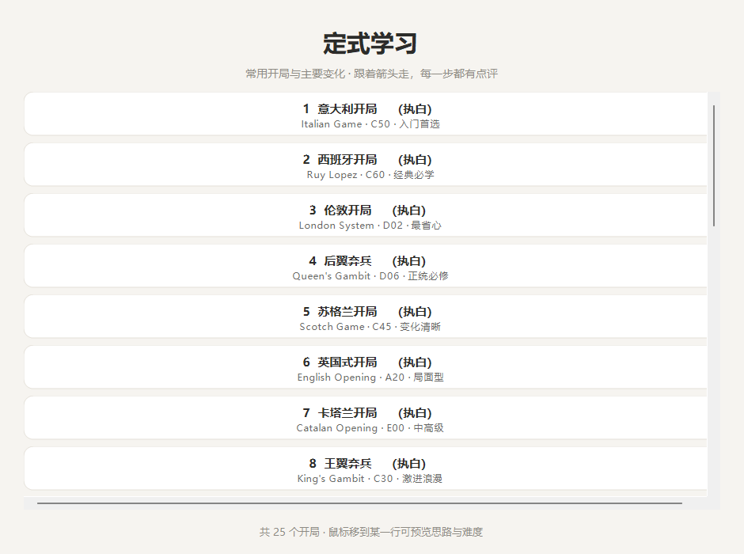
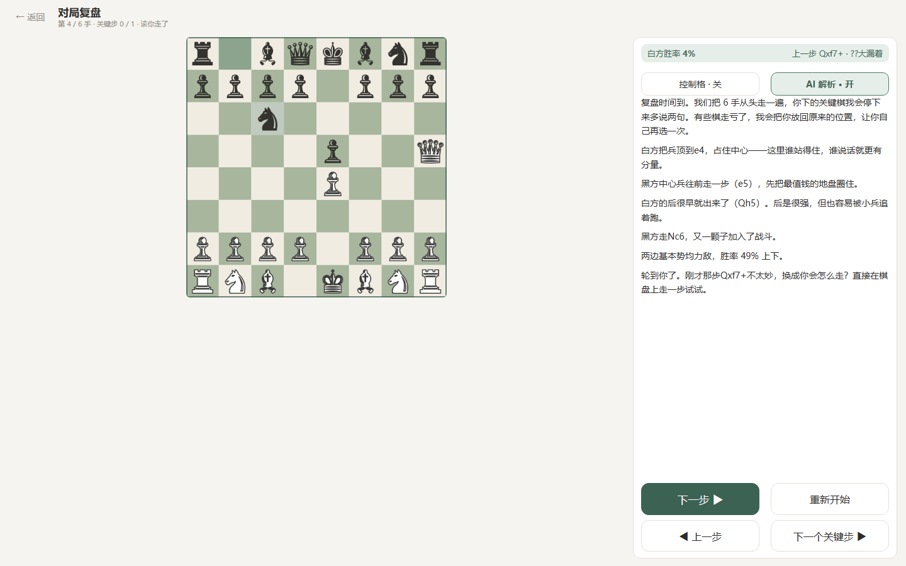
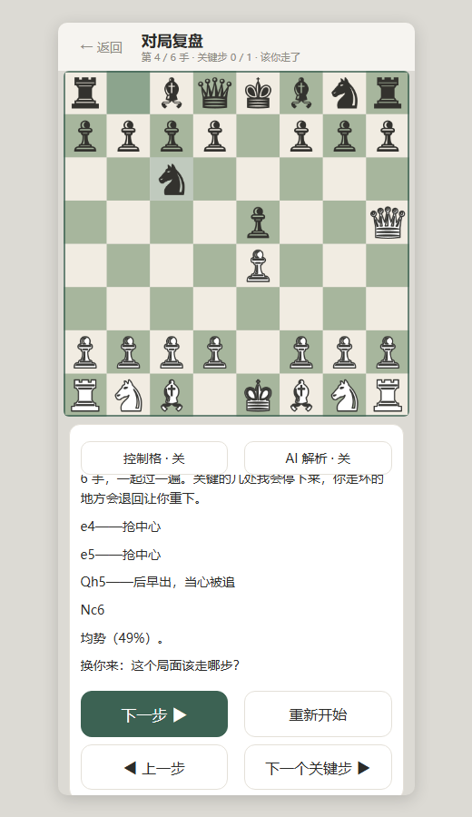

# 国际象棋 · 三端同源

简约风格的单机国际象棋。**同一套规则与 AI，跑在 Windows 桌面、网页、安卓、iOS 上**。
人机对战（ELO 100–2000，20 档）、本地双人、25 个开局定式学习、逐步 AI 解析，以及一个**带引导的多邻国式复盘课**。


---

## 界面

| 对局 + AI 解析 | 复盘（关键步重下） |
| --- | --- |
|  |  |

| 定式学习（25 个开局） | 网页版宽屏三栏 |
| --- | --- |
|  |  |

<p align="center">
  
</p>

## 功能

**三种玩法**

| 入口 | 说明 |
| --- | --- |
| 人机对战 | 先选难度、再选执白/执黑；20 档 ELO，100–2000 每 100 一档 |
| 人人对战（本地） | 两人共用一台设备，每走一步自动翻转棋盘，当前该走的一方永远在下方 |
| 定式学习 | 25 个开局，逐手讲解、分支变化、开局导读与「本步点评」 |

**对局辅助**

- **AI 解析**：实时胜率曲线、逐手评级（`!!` 精彩 / `!` 好棋 / `!?` 有趣 / `?!` 存疑 / `?` 失误 / `??` 大漏着）。
- **控制格**：整块棋盘上色 —— 黑方控制=深、白方控制=白、双方=浅灰、都没=浅绿，一秒钟看清谁的子力压在哪。
- **悔棋 / 新局 / 全屏**（F11、Esc）；窗口任意缩放，逻辑画布 940×700 等比适配并支持高 DPI。

**复盘课**（对局结束后点「复盘」）

1. 自动把整盘棋重走一遍，节奏适中，每手一句「这手干了什么」；
2. 走到**关键步**停下深入点评，点「继续」才往下走；
3. 走坏的棋**退回那一步之前**让你自己重新下：下对了把棋真的落在盘上、停住让你看清；下错了指出亏多少、再试一次；
4. 「◀ 上一步」会把棋盘和对话框**一起退回去**（对话逐行还原，不追加废话），「下一个关键步 ▶」可跳着看。

## 下载与运行

| 平台 | 方式 |
| --- | --- |
| Windows | 到 [Releases](../../releases) 下载 `国际象棋电脑版.zip`，解压后双击 `国际象棋.exe`（需 .NET Framework 4.x，Win10/11 自带） |
| 安卓 | 到 Releases 下载 `国际象棋.apk` 安装（允许「安装未知来源应用」） |
| iOS | 到 Releases 下载 `国际象棋-iOS工程.zip`，用 Xcode 打开工程、换成自己的签名后运行 |
| 网页 | 到 Releases 下载 `国际象棋.html`，双击用浏览器打开即可（单文件、离线可用） |

> 程序没有代码签名，Windows SmartScreen 可能提示「未知发布者」→ 点「更多信息」→「仍要运行」。

## 从源码构建

需要 Windows + Python 3（生成图标与开局数据）+ .NET Framework 4.x 自带的 `csc.exe`。**无需 .NET SDK、无需联网。**

```powershell
# 完整构建：生成图标 → 编译并运行 C# 自检 → 打包 exe
powershell -ExecutionPolicy Bypass -File build.ps1

# 只编译不跑自检
powershell -ExecutionPolicy Bypass -File build.ps1 -SkipTests

# 产物
dist\国际象棋.exe
```

网页 / 安卓 / iOS 共用 `mobile/web` 这一套前端，打包脚本在 `mobile/`：

```powershell
powershell -ExecutionPolicy Bypass -File mobile\build_web.ps1     # 合成单文件 HTML，并同步到 APK 与 iOS 工程
powershell -ExecutionPolicy Bypass -File mobile\android\build_apk.ps1
python mobile\make_ios_zip.py
```

## 测试

| 套件 | 内容 | 运行 |
| --- | --- | --- |
| C# | 走子/吃子/将军/将杀/和棋/易位/吃过路兵/升变、SAN、Zobrist、置换表、开局数据合法性、AI 档位、复盘状态机…（2000+ 断言） | `build.ps1`（自动执行） |
| JS | 与 C# 同构的引擎与规则，覆盖同样的边界（600+ 断言） | `node mobile/test/engine_test.js` |
| 整机 | 程序内 `--selftest`：在真实窗口里点按钮、走子、切页、量尺寸 | `dist\国际象棋.exe --selftest` |

CI 会在每次推送时跑 JS 引擎测试（见 [`.github/workflows/ci.yml`](.github/workflows/ci.yml)）。

## 项目结构

```
src/                  Windows 桌面版（C# / WinForms，单文件 exe）
  Core/               棋盘、走子规则、引擎、评估、开局、AI 解析、复盘状态机
  UI/                 自绘界面：棋盘、对局、难度、菜单、定式学习、复盘、分析面板
tests/TestMain.cs     C# 测试入口（2000+ 断言）
tools/                图标生成、开局数据生成、截图/探针工具、打包脚本
data/openings.json    开局数据（由 tools/gen_openings.py 生成）
mobile/
  web/                网页版：Canvas 渲染 + JS 引擎（与 C# 同构）
  test/               JS 测试
  android/            安卓壳（WebView + 原生资源）
  ios/                iOS 工程（WKWebView）
build.ps1             Windows 版构建脚本
docs/                 截图与详细开发记录
```

## 技术要点

- **引擎**：0x88 棋盘、Zobrist 哈希、alpha-beta + 静态搜索 + 置换表 + 空着裁剪 + killer 着法 + LMR；
  20 档难度由「最大深度 + 思考时间 + 随机失误率」组合而成，低档位会主动犯错，像人而不像机器。
- **规则**：完整合法着法生成（含被牵制判定）、王车易位条件、吃过路兵、升变、50 回合、三次重复、子力不足和棋，
  以及标准 SAN 记谱（含消歧义）。
- **界面**：WinForms 全自绘 —— 逻辑画布 940×700，按窗口与 DPI 等比缩放；棋盘、棋子、面板、按钮都是矢量绘制，
  所以 100%–200% 缩放下都清晰。网页版用同一套配色与布局常量，Canvas 重绘。
- **复盘**：把整盘棋逐手用「快速档」分析一遍 → 按「跳过开局 / 损失阈值 / 是否唯一好棋 / 胜负是否翻面」挑关键步，
  彼此至少隔 4 手、最多 4 个 → 状态机驱动教学（自动播放、关键步停顿、错题回退、答对落子停顿），
  对话流按手数打标签，支持逐行回退。
- **一致性**：C# 与 JS 两份实现共用同一批测试用例与常量表，网页/APK/iOS 三份页面产物逐字节一致。

## 更多文档

- [docs/发布流程.md](docs/发布流程.md)：上传到 GitHub、发版、重新打包的完整步骤
- [mobile/README.md](mobile/README.md)：网页版 / 安卓 / iOS 的构建与调试（含 `?demo=` 调试参数、截图命令）
- [mobile/ios/README.md](mobile/ios/README.md)：iOS 工程说明（用 Xcode 打开、改 Bundle ID、签名）
- 压缩包内 `使用说明.txt`：面向普通玩家的使用指南

## 许可

[MIT](LICENSE) © 2026 Cola-Cockatoo
